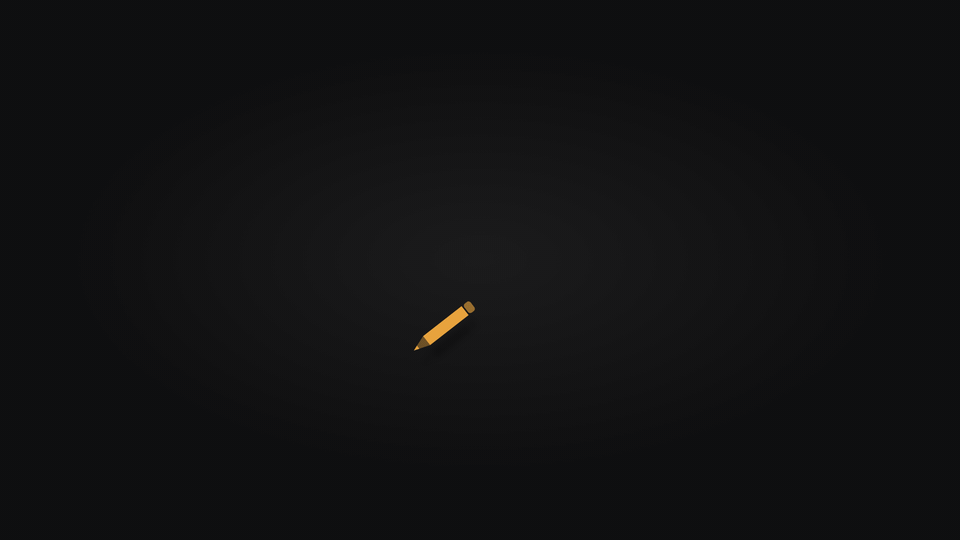
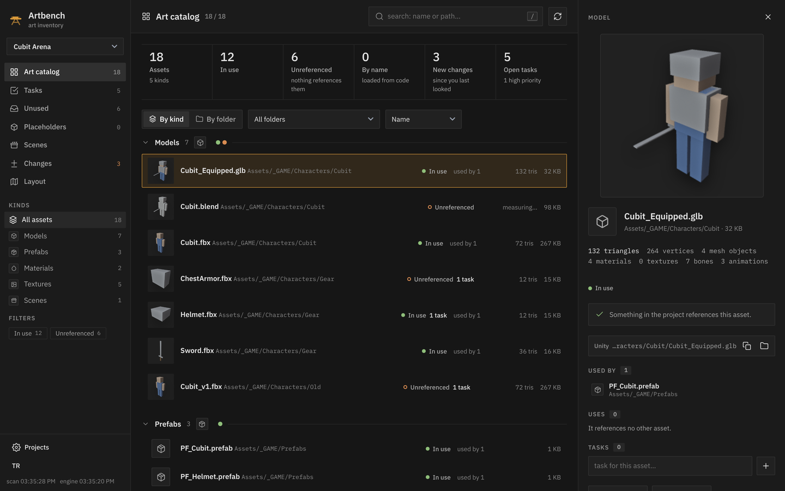
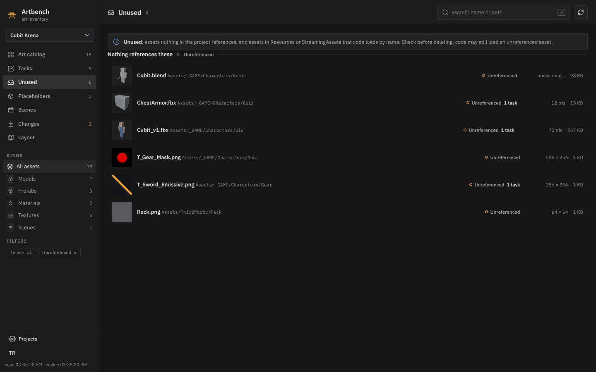
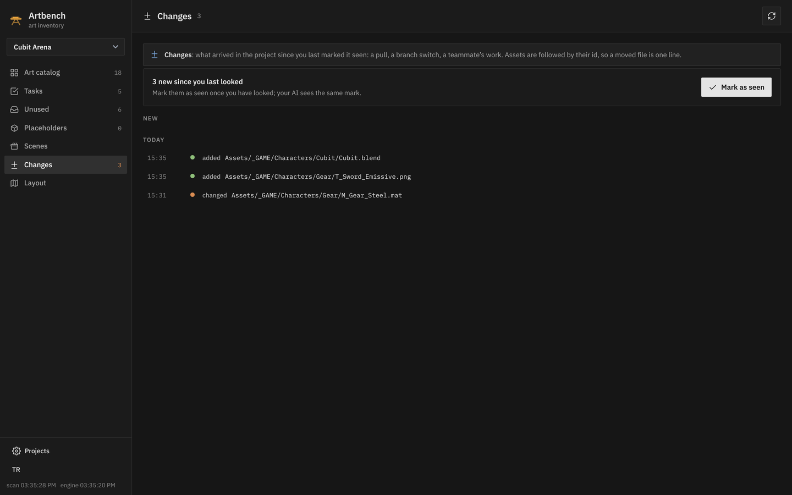
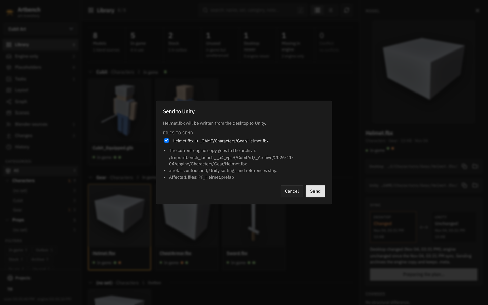
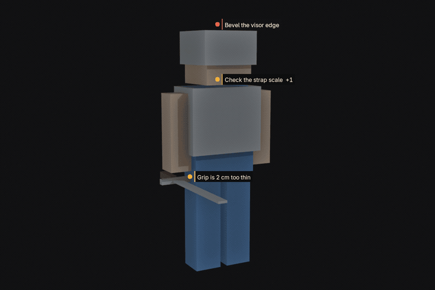
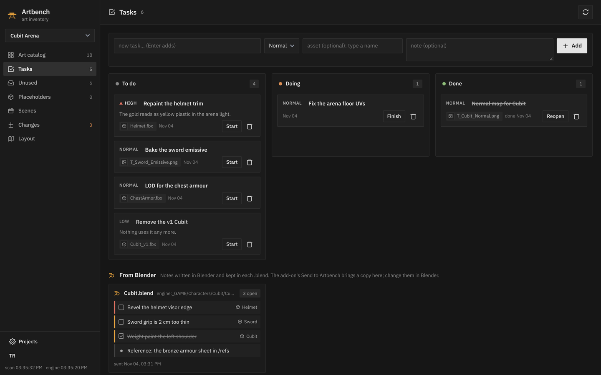
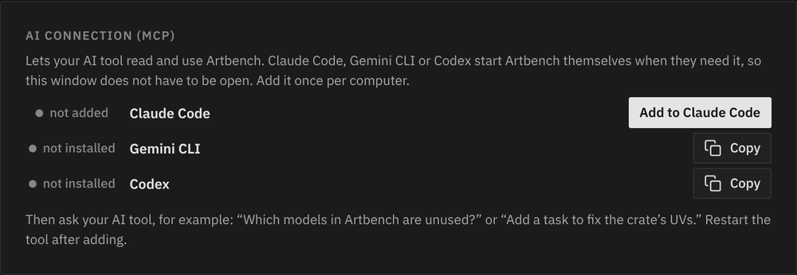

# Artbench



**The art side of your game in one place, for you and for your AI tools.**

### ⬇ [Download Artbench for Windows](https://github.com/Zeatrex01/Artbench/releases/latest/download/Artbench-windows-x64.zip)

Unzip it anywhere and double-click `Artbench.bat`: Python is inside, nothing to install. ·
[artbench.malik3d.page](https://artbench.malik3d.page/) · [all releases](../../releases)

> The green **Code → Download ZIP** button gives the source code, which needs Python 3.11+. To use Artbench, take the
> download above.

[](https://github.com/Zeatrex01/Artbench/actions/workflows/build.yml)


Artbench reads your Unity project, and the art folder you keep beside it if you have one, and answers the questions
an artist asks every day:

- *Which of these textures does nothing use?*
- *What uses this material, and where does it end up in a scene?*
- *What changed after that pull?*
- *Is the model in the game the one on my desktop?*

It runs on your computer, reads the project's own text files without Unity running, and writes nothing into the
game unless you ask it to, file by file, with a plan you confirm first. Your AI tool (Claude Code, Gemini CLI,
Codex) gets the same answers over MCP.

Free to use, change and share for your own work, with credit. Not for sale. See [License](#license).



## What it does

### Know what the game has, and what uses it

Point Artbench at your clone of the Unity project, on any branch.

- **The art catalog.** Models, textures, materials, prefabs, scenes, animations, shaders and audio, grouped by kind
  or by folder, with model renders, triangle counts, texture sizes and formats. Sort by size, triangles or last
  change; hide a folder you do not care about (what it uses still counts).
- **Honest usage.** *In use*, *unreferenced*, *loaded by name* (Resources, StreamingAssets) or *unknown* when the
  project is not saved as text. Read from the `.meta` files and the text-serialized scenes, prefabs and materials.
- **References both ways.** What each asset uses, and what uses it. Build scenes and Project Settings count.
- **Open a model in Blender** from its card.



### See what changed since you last looked

After a `git pull`, a branch switch or a teammate's work: what was added, changed, moved and removed, in one list.
Mark it as seen and the list starts again from there. Your AI tool sees the same mark.



### Keep your art folder and the game in step

With an art folder beside the game (FBX, Blender files, textures), Artbench is the bridge between the two:

- **Each model's state:** in game, outbox, stock or archive, and whether the copy in the game matches yours.
- **Send to Unity, pull from Unity, bring a Unity model into your art folder.** File by file, always with a plan
  first. The `.meta` stays, so Unity keeps its settings and references; the overwritten copy goes to an archive.
- **A file changed on both sides is a conflict** that waits for your decision. Nothing is overwritten silently.
- **What changed inside a model:** objects, vertices, materials, bones and animations, measured by Blender running
  in the background.



### Notes that sit on the model, in Blender

The Artbench Bridge add-on keeps notes and to-dos inside the `.blend`, pinned to objects: a small pin and the note's
first line float beside the object in the 3D view. Right-click an object > *Add note*. They work with Artbench
closed and travel with the file. When Artbench runs, *Send to Artbench* hands it a copy, shown beside the task board.



### One task board, for you and your agent

Tasks with priorities, tied to an asset when you want; the asset's card shows them. Your AI tool reads and adds
tasks too. Notes sent from Blender sit beside the board, one card per `.blend`.



### Your AI tools know it too

34 MCP tools (21 for a game project on its own), the same operations as the page: *"What does nothing use?"*,
*"What changed since my last look?"*, *"Add a high-priority task to repaint the crate."* The page adds Artbench to
Claude Code in one click and gives the lines for Gemini CLI and Codex.



## Get it

**Windows, ready to run.** [Download the newest build](https://github.com/Zeatrex01/Artbench/releases/latest/download/Artbench-windows-x64.zip) (or a given version from
[Releases](../../releases), or the [download page](https://artbench.malik3d.page/)), unzip it anywhere (not inside a game project) and double-click `Artbench.bat`. Python is
inside; there is nothing to install. The `README.txt` in the folder covers the rest.

**From source**, on Windows, Linux or macOS (macOS untested). You need Python 3.11 or newer. Artbench uses the standard library only: nothing to install. Blender is optional; it
adds previews and model statistics.

```bash
git clone https://github.com/Zeatrex01/Artbench.git
cd Artbench
python -m artbench setup "D:/Projects/YourUnityProject"   # connects the project, prints the AI tool lines
python -m artbench                                         # opens http://127.0.0.1:8765/
```

On Windows, `ArtbenchSetup.bat "D:\Projects\YourUnityProject"` and `Artbench.bat` do the same.
`python -m artbench shortcut` puts an Artbench shortcut on the desktop that opens it in a window of its own.
**`Build.bat`** (or `python tools/build_portable.py`) builds the Windows download above into `dist/`. To keep an art folder beside the
game, open **Projects → Game project + art folder** in the page.

Artbench writes nothing into the Unity project on its own. Its files live in `projects/<id>/` for a game project on
its own, or in your art folder.

### The Blender add-on

```bash
python -m artbench addon            # writes artbench_bridge.zip
```

In Blender 4.2 or newer: *Edit → Preferences → Get Extensions → Install from Disk*, pick the zip. The add-on's tab
is in the 3D view's sidebar (`N`): **Notes**, and **Artbench link** with the connection in plain words.

### Your AI tool

`setup` prints the lines for Claude Code, Gemini CLI and Codex; `--mcp claude` adds it to Claude Code for you. By
hand, for Claude Code:

```bash
claude mcp add --scope user artbench -e PYTHONPATH=/path/to/Artbench -- python -m artbench.mcp_server
```

Scripts, and agents without MCP, use the command line; every answer is JSON:

```bash
python -m artbench ops                                     # the operations and their arguments
python -m artbench call search --project demo --arg query=crate --compact
```

## The rule

No file is silently overwritten, on either side:
- Artbench records the last state both sides agreed on. When only one side has changed since then, that side is
  newer; when both have changed, it is a conflict.
- Nothing is sent or pulled without your confirmation of a plan that lists every file.
- Overwritten copies go to `_Archive/<date>/`; nothing is deleted.
- Git stays your tool; Artbench never runs it.

## Status

Works today with Unity, on Windows and Linux (macOS is untested). Next, in this order:
1. A canvas for tasks and for comparing art side by side.
2. A Blender MCP that works with or without Artbench: the scene, its changes, export templates per project.
3. Godot.

The team side comes after those. The roadmap is in [`ARCHITECTURE.md`](ARCHITECTURE.md#roadmap).

## Documentation

- [`ARCHITECTURE.md`](ARCHITECTURE.md): layers, schemas, the HTTP API and the MCP tools.
- [`README_TR.md`](README_TR.md): the user guide, in Turkish.
- [`docs/`](docs/README.md): the design system and the engine bridge contract.

## Building

`Build.bat` (or `python tools/build_portable.py`) makes the Windows download in `dist/`. At every push, CI builds it
on Windows, starts it with its own Python and checks that it answers; a version tag publishes it as a Release (see
[`CONTRIBUTING.md`](CONTRIBUTING.md)). The download page is `site/`; `python tools/build_site.py` builds it into
`dist/site`, and after every release it is published with GitHub Pages pointing at the new zip.

## License

Use it, change it and share it, for yourself and for your work, with credit ("Artbench by Zeatrex01"); do not sell it.
Formally: the [Apache License 2.0](LICENSE) with the Commons Clause License Condition v1.0, which takes away the right
to sell Artbench, or a product or service whose value comes mainly from it. The Blender add-on in `blender_addon/`
is under the Apache License 2.0 alone, as Blender add-ons must stay GPL-compatible. See [`NOTICE`](NOTICE) and
[`THIRD_PARTY_NOTICES.md`](THIRD_PARTY_NOTICES.md). Copyright 2026 Zeatrex01.
